# Simulating Fluid Flow with the SIMPLE Method

This article describes the SIMPLE method (Semi-Implicit Method for Pressure-Linked Equations). The method was proposed by S. Patankar and D. Spalding in 1972 [2]. The article covers the governing equations, control volume discretization, the staggered grid, the SIMPLE algorithm itself, boundary conditions, solving the linear systems, and under-relaxation. At the end there is a link to a test program in Octave that computes the flow in a lid-driven cavity. The presentation follows S. Patankar's book *Numerical Heat Transfer and Fluid Flow* [1] (hereafter "Patankar"), Chapters 2–6. Where we depart from the book, this is stated explicitly.

For comparison, the article on Chorin's projection method [8] is useful, but you do not need to know it.

---

## 1. Equations

The flow of a viscous incompressible fluid is described by the Navier–Stokes equations:

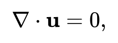

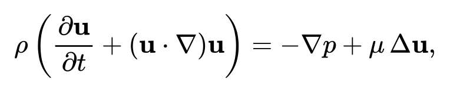

where **u** = (u, v) is the velocity, p is the pressure, ρ is the density, and μ is the dynamic viscosity (the kinematic viscosity is ν = μ/ρ). There are no body forces. Bold **u** denotes the velocity vector, plain u its x-component. Patankar writes the equations in terms of μ rather than ν, and we follow him.

**Conservative form.** Because the fluid is incompressible, the convective term can be moved under the derivative: u·∂u/∂x + v·∂u/∂y = ∂(uu)/∂x + ∂(vu)/∂y. The difference between the two forms is u·(∂u/∂x + ∂v/∂y) = 0. We obtain a system of three scalar equations for the three unknowns u, v, p:

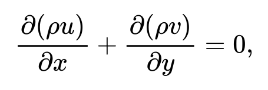

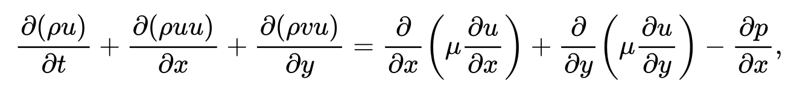

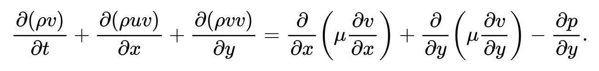

The conservative (divergence) form is convenient because every term is a derivative of a flux. This is the form the control volume method works with (Section 2).

### 1.1. The general transport equation

The central idea of Patankar's book is that the equations of motion, heat conduction, species diffusion and many others all have the same form

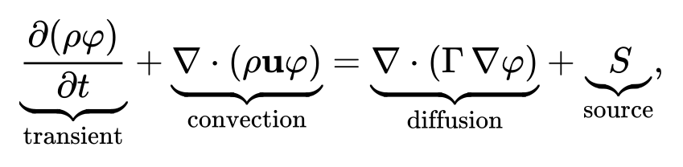

where φ is the transported quantity, Γ is the diffusion coefficient, and S is the source.

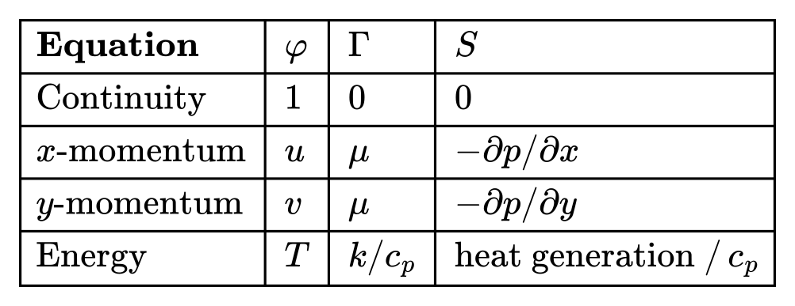

So it is enough to learn once how to discretize the general equation (Section 2), and the same procedure works for all the equations at once. Only the pressure needs special attention.

### 1.2. The pressure problem

Pressure has no equation of its own. The momentum equations contain p, but they serve to determine u and v. The continuity equation, the only one left, does not contain p at all. Pressure is defined indirectly: it is the field which, when substituted into the momentum equations, yields a velocity that satisfies continuity.

This gives two ways to find the pressure:

- **Chorin's method** [8]: at every time step, a Poisson equation for pressure is solved that makes the velocity divergence-free.
- **The SIMPLE method**: the pressure is guessed and then iteratively corrected according to how badly continuity is violated.

In addition, the equations are nonlinear: the coefficients of the discrete momentum equations depend on the velocity itself. So for a steady problem iterations are needed anyway, and SIMPLE resolves the nonlinearity and the pressure in a single iteration loop.

Before turning to the SIMPLE algorithm itself (Section 4), we need to learn how to write the equations in discrete form (Section 2) and decide at which grid points to store velocity and pressure (Section 3).

---

## 2. Spatial discretization

### 2.1. The control volume method

Write the steady general equation (Section 1.1) in terms of the flux **J**:

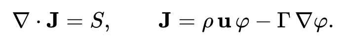

The flux **J** consists of a convective part (the moving fluid carries φ along) and a diffusive part (φ spreads from where there is more of it to where there is less). Divide the domain into control volumes (CVs) and integrate the equation over the CV around node P. We use Patankar's notation: nodes are denoted by capital letters P (current), E, W, N, S (east, west, north and south neighbours), and the CV faces between them by lowercase e, w, n, s. The problem is two-dimensional, so all quantities are per unit depth: the area of face e is A\_e = Δy · 1.

```
                                 N
                                 *
                                 :
   ---               +-----------n-----------+
    ^                |                       |
    |                |                       |
    |      W         |           P           |         E
 Δy |      *.........w...........*...........e.........*
    |                |                       |
    |                |                       |
    v                |                       |
   ---               +-----------s-----------+
                                 :
                                 *
                                 S

           |<------ δx_w ------->|<------ δx_e ------->|
                     |<-------- Δx --------->|
```

Asterisks are nodes; the rectangle is the CV of node P, of size Δx × Δy. The CV faces lie between nodes; δx\_e and δx\_w are the distances from P to the neighbours E and W (on a uniform grid they equal Δx).

By the divergence (Gauss) theorem, the volume integral of a divergence equals the flux through the boundary. For a rectangular CV with faces e, w, n, s:

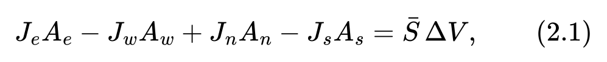

where J\_e is the x-component of the flux at face e, J\_n the y-component at face n, and ΔV = Δx·Δy. This is a **balance equation**: outflow through the faces minus inflow equals what is generated inside. The flux through a face shared by two neighbouring CVs enters their equations with opposite signs, so summing the equations of all CVs gives an exact balance for the whole domain. The scheme is **conservative**: neither mass nor momentum is created or destroyed inside the domain by discretization errors.

What remains is to express the face fluxes through nodal values. Whatever method is used, the result is written as

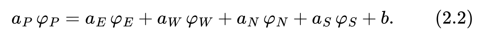

Patankar (Ch. 3–4) formulates **four basic rules** that a discretization must satisfy to give physically realistic results:

1. **Consistency at control volume faces.** The flux through a shared face must be computed by the same expression for both adjacent CVs. Otherwise conservation is violated.
2. **Positive coefficients.** All a\_nb and a\_P must be positive. An increase of φ at a neighbouring node, all else being equal, must raise φ\_P, not lower it.
3. **Negative-slope source linearization.** If the source depends on φ, it is written as S = S\_C + S\_P·φ\_P with S\_P ≤ 0.
4. **Sum of the neighbour coefficients.** In the absence of a source, a\_P = Σ a\_nb: if all neighbours have the same value of φ, then φ\_P must have that value too.

### 2.2. Diffusion

The diffusive flux through face e is approximated by the difference of the values at the adjacent nodes:

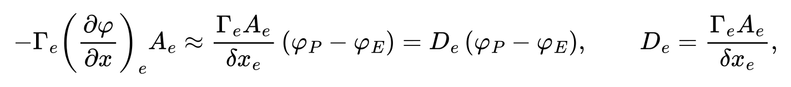

where δx\_e is the distance between nodes P and E. It is convenient to think of D\_e as the "conductance" of the face: the larger it is, the more strongly the nodes are coupled. Without convection we would get a\_E = D\_e, a\_W = D\_w, a\_N = D\_n, a\_S = D\_s.

### 2.3. Convection and diffusion: choosing a scheme

The convective flux through face e is F\_e·φ\_e, where

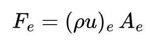

is the **mass flow rate** through the face. A new difficulty appears here: we need the value φ\_e at the face, but only nodal values are known. The ratio of convection to diffusion at a face is characterized by the **grid Péclet number**

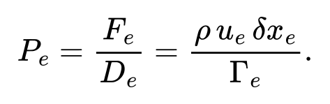

For the momentum equations Γ = μ, and the Péclet number coincides with the grid Reynolds number ρu·δx/μ.

**Central differencing.** The natural choice is the average: φ\_e = (φ\_P + φ\_E)/2. Then

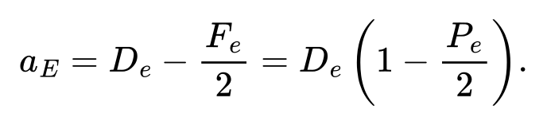

For P\_e > 2 the coefficient becomes negative, and rule 2 is violated. In practice this produces unphysical sawtooth oscillations in the solution and divergence of the iterations.

**The upwind scheme.** The face value is taken from the upstream node: φ\_e = φ\_P if F\_e > 0 and φ\_e = φ\_E if F\_e < 0. Then

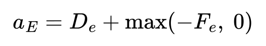

is always positive. The price is first-order accuracy and **numerical (false) diffusion**: when the flow is oblique to the grid lines, the scheme smears the solution as if the viscosity were larger than it really is.

**The exact solution and the power-law scheme.** Patankar (Ch. 5) derives a scheme from the exact solution of the one-dimensional steady convection–diffusion equation. Between two nodes the solution has an exponential profile:

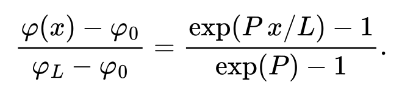

As |P| → 0 the profile is linear (pure diffusion; central differencing is correct). For large |P| the profile is nearly constant and equal to the upstream value, changing sharply only near the downstream node: the face value is close to the upwind value, and diffusion is almost switched off. The exponential scheme is exact for the one-dimensional problem, but the exponential is expensive to compute. Patankar proposes a cheap and very accurate approximation of it, the **power-law scheme**.

**The general formula.** All of these schemes fit into a single expression:

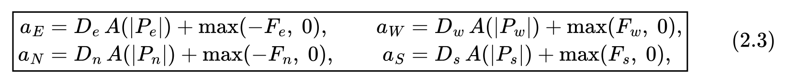

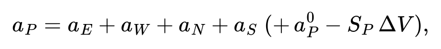

where the scheme is determined by the function A(|P|):

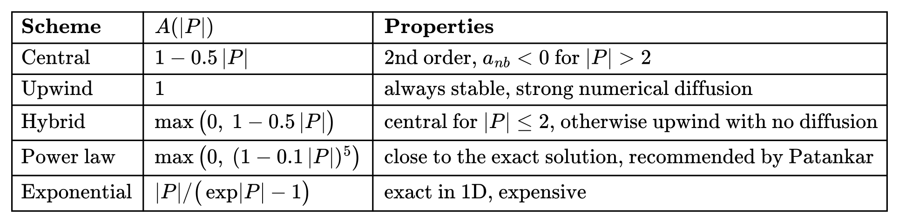

The first term in (2.3) is diffusion, damped when convection is strong; the second is convection, which carries information only downstream.

**A note on a\_P.** Strictly speaking, integration gives a\_P = Σ a\_nb + (F\_e − F\_w + F\_n − F\_s). The last bracket is the mass balance of the CV, which is zero for a field that satisfies continuity. Patankar drops it right away. This way rule 4 holds exactly, and diagonal dominance a\_P ≥ Σ a\_nb is preserved during intermediate iterations. We do the same.

---

## 3. The staggered grid

### 3.1. Checkerboard pressure

Why not store u, v and p at the same points? Patankar (Ch. 6) shows that such a (collocated) grid hides a trap. The pressure gradient at node P computed by a central difference,

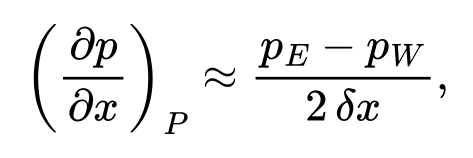

does not contain p\_P. Take a "checkerboard" pressure field: along a grid line the values alternate 100, 300, 100, 300, … At every node p\_E = p\_W, and the difference is zero. The momentum equation "sees" this highly non-uniform field as a constant one. If such a field satisfies the equations, then so does the solution with any checkerboard field added to it, and the numerical solution may contain unphysical sawtooth pressure oscillations.

The same happens with continuity: the difference u\_E − u\_W is zero for a zigzag velocity 1, 7, 1, 7, …

### 3.2. The staggered (MAC) grid

The remedy is to store the velocity components on the faces of the pressure cells (Harlow & Welch, 1965 [3]):

- p at the cell centre;
- u at the centres of the vertical (left/right) faces;
- v at the centres of the horizontal (bottom/top) faces.

```
              v(i-1,j+1)              v(i,j+1)
     +-----------o-----------+-----------o-----------+
     |           :           |           :           |
     |           :           |           :           |
     o           *           o           *           o
 u(i-1,j)    p(i-1,j)      u(i,j)      p(i,j)     u(i+1,j)
     |           :           |           :           |
     |           :           |           :           |
     +-----------o-----------+-----------o-----------+
              v(i-1,j)                v(i,j)
```

Now the pressure difference p\_P − p\_E between neighbouring cells falls exactly on the face where the velocity u\_e lives, and the difference of the face fluxes of a cell gives its divergence without interpolation. A checkerboard pressure produces a difference of ±200 on every face and is immediately "noticed" by the momentum equation.

**Three kinds of control volumes.** Each equation is integrated over its own CV:

- the continuity equation (and, in Section 4, the pressure-correction equation for p') over the pressure cell (solid lines in the figure);
- the equation for u(i,j) over a CV shifted by half a cell in x. In the figure it is the rectangle between the dotted lines: its faces pass through the nodes p(i−1,j) and p(i,j), and its corners through the v nodes;
- the equation for v(i,j) over a CV shifted by half a cell in y.

The pressure force on the CV of velocity u(i,j) is the difference p(i−1,j) − p(i,j) between its faces times the face area Δy. No pressure interpolation is needed.

**Alternative.** On a collocated grid, checkerboard oscillations are suppressed by a special interpolation of the velocity to the faces (Rhie & Chow, 1983 [6]). This is how most industrial codes for unstructured grids work. This article uses a staggered grid, as Patankar does.

### 3.3. Array storage

The L × H domain is divided into n\_x × n\_y equal cells with spacings Δx = L/n\_x, Δy = H/n\_y. The first array index corresponds to x, the second to y:

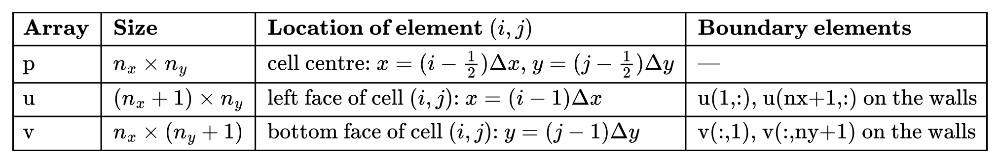

The unknowns are `u(2:nx, :)` and `v(:, 2:ny)`. The elements on the walls hold the prescribed values of the normal velocity. There are no ghost nodes outside the boundary: the conditions for the tangential velocity are built directly into the coefficients (Section 5.1).

### 3.4. Momentum equations on the staggered grid

**Equation for u(i,j)**, i = 2, …, n\_x, j = 1, …, n\_y. Its CV spans, in x, the interval between the centres of cells i−1 and i, and in y the row of cells j. The mass flow rates through the CV faces are computed by interpolating the velocity from neighbouring nodes:

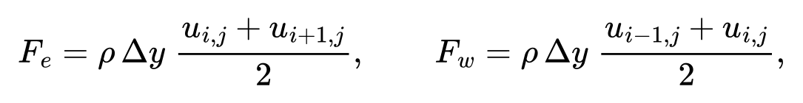

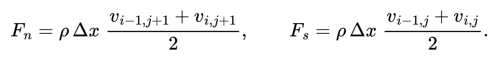

Face conductances:

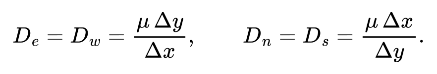

The coefficients are computed from (2.3), the neighbours are the nodes u\_(i±1, j), u\_(i, j±1), and the pressure term is

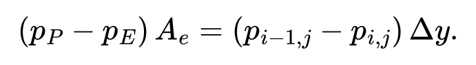

**Equation for v(i,j)**, i = 1, …, n\_x, j = 2, …, n\_y, is symmetric:

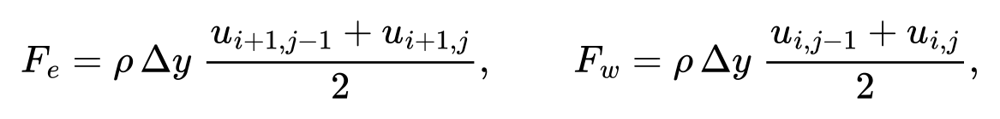

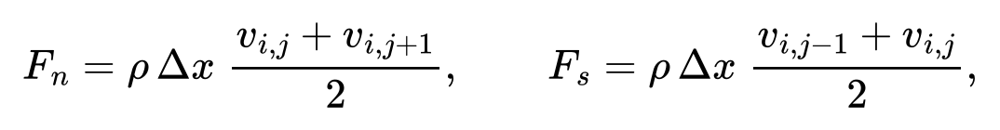

with the pressure term (p\_(i, j−1) − p\_(i, j))·Δx.

**Nonlinearity.** The flow rates F depend on the very velocity we are solving for. They are computed from the velocity of the previous iteration and treated as known. The equations become linear, and the nonlinearity is resolved by the outer SIMPLE iterations, the same ones that refine the pressure.

---

## 4. The SIMPLE algorithm

SIMPLE works on a "guess and correct" principle:

1. **Guess the pressure** p\*.
2. **Solve the momentum equations with this pressure.** This gives the velocity **u**\* = (u\*, v\*). Since the pressure guess is wrong, **u**\* does not satisfy continuity: some cells receive more inflow than outflow, others less.
3. **Correct the pressure and velocity.** Find a pressure correction p' such that the corrected velocity satisfies continuity. Where fluid has "accumulated", the pressure rises and pushes the excess out to the neighbours.
4. **Repeat** until the fields stop changing.

### 4.1. Discrete equations

The momentum equations for the staggered-grid nodes are written in Section 3.4. For deriving SIMPLE, the specific form of the coefficients does not matter; only the structure does. We write the equations in the notation of Section 2.1: the velocity u\_e is stored on face e between pressure nodes P and E, and the face area is A\_e = Δy.

**Momentum equation** for node u\_e:

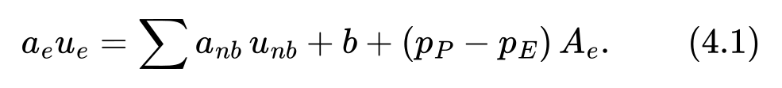

- a\_e is the coefficient showing how strongly the velocity at the node is coupled to its neighbours;
- Σ a\_nb·u\_nb is the influence of the neighbouring velocity nodes (subscript nb for neighbour) through convection and diffusion;
- b contains other sources and known boundary values;
- (p\_P − p\_E)·A\_e is the pressure force acting on the control volume: the pressure difference times the face area.

Similarly for v\_n:

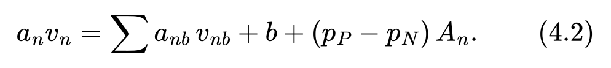

**Continuity equation** for cell P (constant-density fluid): as much mass must flow out through the cell faces as flows in:

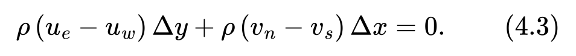

### 4.2. Pressure and velocity corrections

Write the sought fields as the guessed ones plus corrections:

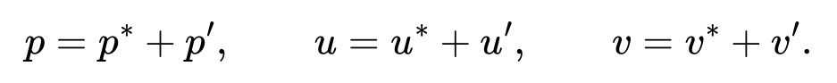

The velocity u\* is obtained from equation (4.1) with pressure p\*:

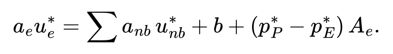

Subtract this from (4.1). The term b cancels:

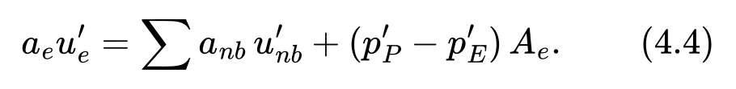

The velocity correction at a node depends on the nearby pressure corrections and on the velocity corrections at all neighbouring nodes. These in turn depend on their neighbours, and so on across the whole domain. **The key simplification of SIMPLE: the term Σ a\_nb·u'\_nb is dropped.** Then

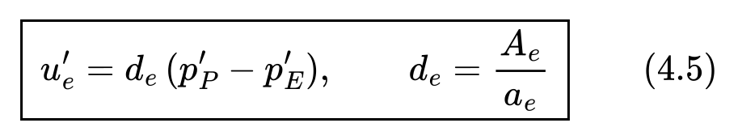

and the corrected velocity is

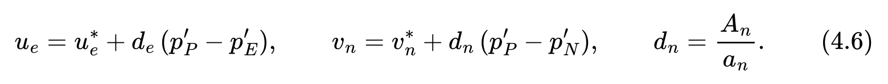

Hence the name of the method: the velocity correction implicitly accounts only for the pressure-correction difference across "its own" face, while the influence of neighbouring velocities is omitted. The method is "semi-implicit".

**Why this is allowed.** The simplification changes only the path to the solution, not the solution itself. At convergence the guessed pressure becomes correct, p' = 0, u' = 0, and the dropped term is zero as well. The converged solution satisfies the original equations (4.1)–(4.3) without any simplifications. The price of the simplification is that the correction p' comes out too large and has to be damped by under-relaxation (Section 7).

### 4.3. The pressure-correction equation

Substitute the corrected velocities (4.6) into the continuity equation (4.3) and collect the terms with p':

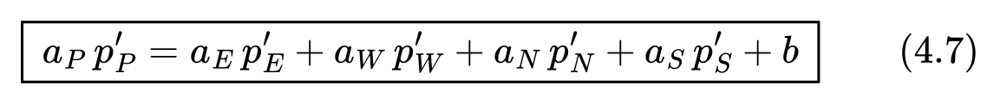

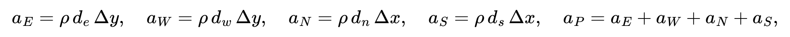

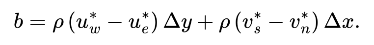

The right-hand side b is the **mass imbalance** of the cell for the field **u**\*: how much more mass flows into the cell than out of it. The meaning of the equation is clear:

- if b > 0 (fluid accumulates in the cell), the correction p'\_P comes out larger than at the neighbours, and the corrected velocities (4.6) point out of the cell;
- if b = 0 in every cell, then p' = 0: the field **u**\* already satisfies continuity. So the total imbalance b serves as one of the convergence indicators; in addition, the residuals of the momentum equations must also be small (Section 7.6).

### 4.4. The pressure-correction equation in index form

For cell (i, j), equation (4.7) becomes

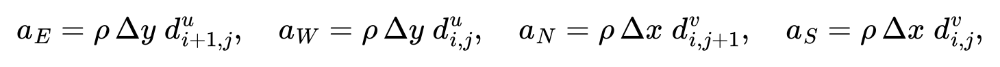

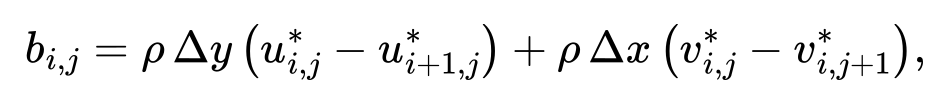

where dᵘ\_(i,j) = Δy / aᵘ\_(i,j) is the coefficient d for node u(i,j) and aᵘ\_(i,j) is the diagonal coefficient of its momentum equation (similarly for dᵛ). The velocity correction is:

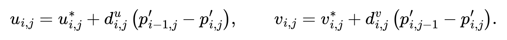

Note the symmetry: the coefficient a\_E of cell (i,j) equals the coefficient a\_W of cell (i+1,j). The matrix of the system for p' is symmetric (Section 6).

### 4.5. Sequence of operations

The SIMPLE algorithm according to Patankar (Ch. 6):

1. Set an initial pressure field p\* (and an initial velocity field, from which the coefficients are computed).
2. Solve the momentum equations (4.1), (4.2) with pressure p\* to get u\*, v\*.
3. Solve the pressure-correction equation (4.7) to get p'.
4. Correct the pressure: p = p\* + p' (with under-relaxation: p = p\* + α\_p·p', Section 7).
5. Correct the velocity using (4.6).
6. Solve the equations for other quantities φ (temperature, concentration) if they affect the flow (not the case in our problem).
7. Take p as the new p\*, recompute the coefficients from the new velocity and return to step 2. Repeat until the residuals are small.

```
            ┌────────────────────────────────┐
            │  initial u, v, p*              │
            └───────────────┬────────────────┘
                            ▼
   ┌──────────────────────────────────────────────────┐
   │ 2. coefficients a from current velocity;         │◄────────┐
   │    momentum equations with p*  →  u*, v*         │         │
   └───────────────┬──────────────────────────────────┘         │
                   ▼                                            │
   ┌──────────────────────────────────────────────────┐         │
   │ 3. p' equation (RHS = mass imbalance             │         │
   │    of u*, v*)  →  p'                             │         │
   └───────────────┬──────────────────────────────────┘         │
                   ▼                                            │
   ┌──────────────────────────────────────────────────┐         │
   │ 4–5. p = p* + αp·p';   u = u* + d·Δp'            │         │
   └───────────────┬──────────────────────────────────┘         │
                   ▼                                            │
            residuals small? ── no ──── p* := p ────────────────┘
                   │
                  yes
                   ▼
                  end
```

---

## 5. Boundary conditions

### 5.1. Velocity

The domain boundary runs along the faces of the pressure cells. On each side, one velocity component is **normal** to the boundary and the other is **tangential**, and their nodes are located differently.

- **Normal component.** The nodes lie right on the boundary (`u(1,:)`, `u(nx+1,:)`, `v(:,1)`, `v(:,ny+1)`). The prescribed value is simply written into these elements. The nearest interior node is a full cell away from the boundary node, so its equation is built in the usual way. The boundary node is a neighbour with a known value, and the term a\_nb·φ\_b is moved to the right-hand side b.
- **Tangential component.** There are no nodes on the boundary: for example, the node u(i,1) closest to the bottom lies at height Δy/2. Face s of its CV coincides with the wall. There is no convection through the wall (F\_s = 0, since v = 0), and the diffusive friction flux is computed over a distance of **half a cell**:

  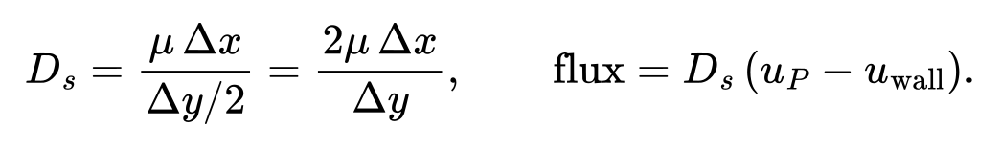

  The wall value acts as a neighbour with a known value: a\_S = D\_s stays in a\_P, and a\_S·u\_wall goes into b.

```
 tangential (u at bottom):                 normal (v at bottom):

 y = Δy/2  ── o  u_P  (interior)           y = Δy  ── o  v_P  (interior)
                 ↕ Δy/2                                 ↕ Δy
 y = 0   ══════════════  wall, u_b         y = 0   ═══ o ═══  v_b  (on boundary)
```

**Relation to ghost nodes.** In Chorin's method [8] the same condition is imposed through a ghost node beyond the wall with value u\_gh = 2u\_b − u\_P. Substituting it into the usual difference gives (u\_P − u\_gh)/Δy = (u\_P − u\_b)/(Δy/2), the same formula. The two approaches are equivalent; Patankar simply builds the boundary condition into the coefficients instead of storing it in extra array elements.

### 5.2. Types of velocity conditions

Denote the normal component by u\_n and the tangential one by u\_t.

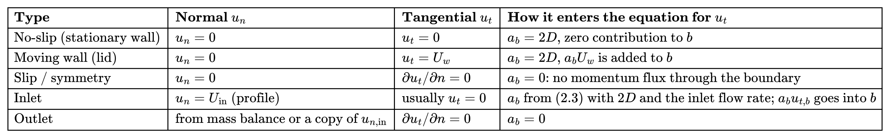

Here a\_b is the coefficient coupling to the boundary value and D is the ordinary face conductance. At an inlet there is also a convective flux through the boundary, so the convective part of formula (2.3) is added to diffusion.

### 5.3. Pressure correction

Pressure has no physical boundary condition of its own. The condition for p' follows from what the correction (4.6) does to the normal velocity at the boundary (Patankar, Ch. 6).

**Prescribed normal velocity** (walls, inlet). The boundary velocity is already correct and is not corrected: u'\_b = 0. Hence d\_b = 0 for the boundary face, and the coefficient coupling to the outside in equation (4.7) is zero. The value of p' beyond the boundary is not needed, and the known flow rate ρ·u\_b·A\_b enters b. This is the discrete analogue of the condition ∂p'/∂n = 0.

**Prescribed pressure** (outlet to the atmosphere, flow driven by a pressure difference). The boundary pressure is already correct, so p'\_b = 0: this is a Dirichlet condition, and the boundary value of p' becomes a known neighbour. The normal velocity at such a boundary is not known in advance and is found from the correction (4.6) or from the mass balance.

### 5.4. Pressure is relative

In an incompressible fluid only the pressure gradient matters: adding any constant to p changes nothing in the momentum equations. If the normal velocity is prescribed on all boundaries (as in the cavity), then p' is also determined only up to a constant. Formally this is seen from (4.7): in every cell a\_P = Σ a\_nb, the row sums of the matrix are zero, and the matrix is singular.

A solution of such a system exists only if the sum of the right-hand sides is zero. The sum of b over all cells is the total mass imbalance of the whole domain. Fluxes through interior faces cancel, leaving the fluxes through the boundary. In the cavity they are zero, so the condition is satisfied.

The level of p' is fixed in one of two ways: set p' = 0 in one cell, or let an iterative method work with the singular system and subtract the mean.

---

## 6. Solving the linear systems

At every SIMPLE iteration, three linear systems of the form (2.2) are solved: for u\*, for v\* and for p'. All have a five-point stencil: each row has at most five nonzero entries. But the properties of the systems differ.

- **Momentum equations.** The matrix is non-symmetric: because of convection, a\_E of node P is not equal to a\_W of node E. On the other hand, it is diagonally dominant, a\_P ≥ Σ a\_nb, and with under-relaxation (Section 7) strictly so, which guarantees convergence of simple iterative methods. The coefficients change at every iteration.
- **The p' equation.** The matrix is symmetric and, with velocity conditions on the whole boundary, singular (Section 5.4). This is an elliptic equation: a correction in one cell affects the whole domain, so simple iterative methods converge slowest on it. How well the corrected velocity conserves mass depends on how accurately it is solved.

**An exact solution is not required.** The coefficients are recomputed at the next iteration anyway, and p\* is wrong until the very end. Solving intermediate systems to machine precision is pointless: reducing the residual by a few times is usually enough. What matters is the convergence of the outer iterations.

### 6.1. The line-by-line method

Patankar (Ch. 4) recommends the **tridiagonal matrix algorithm** (TDMA, also known as the Thomas algorithm). For a one-dimensional problem the equations have the form

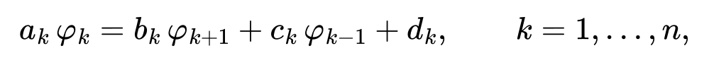

with c₁ = 0 and b\_n = 0. The forward sweep computes the recurrence coefficients

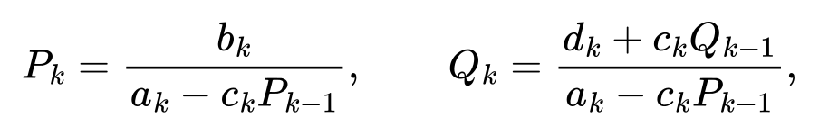

and the back substitution recovers the solution φ\_n = Q\_n, φ\_k = P\_k·φ\_(k+1) + Q\_k. The cost is O(n) operations.

In two dimensions the **line-by-line TDMA** is used. Take one grid line, for example column i. The values on the neighbouring lines i±1 are treated as known (the latest computed values are used), their contribution is moved to the right-hand side, and a tridiagonal system is solved along the line. All lines are swept this way, then the direction is switched: rows instead of columns. In one sweep, boundary information propagates along the entire line at once rather than one cell at a time as in Gauss–Seidel. That is why the method converges noticeably faster than point-by-point iterations. For the momentum equations one or two sweeps per SIMPLE iteration are usually enough; for p', several.

### 6.2. What the program uses

In the test program the systems are assembled into sparse matrices and solved with a direct method, the `\` operator (for sparse matrices Octave uses sparse LU factorization). The reasons:

- **Simplicity and speed in Octave.** Loops in Octave are slow, while matrix assembly and the call to `\` are fully vectorized.
- **A small grid.** For a 64×64 cavity each system has about 4000 unknowns, and the sparse factorization takes milliseconds.

For large grids and 3D problems, direct methods require too much memory. Then line-by-line TDMA, SOR or multigrid methods are used. Iterative and direct methods are discussed in detail, using the heat equation as an example, in articles [9], [10].

---

## 7. Under-relaxation and convergence

The stability of the SIMPLE iterations is ensured by **under-relaxation**, an artificial slowing of the changes between iterations.

### 7.1. Why it is needed

Without relaxation SIMPLE usually diverges, for two reasons:

- **Nonlinearity.** The coefficients of the momentum equations are computed from the velocity of the previous iteration. If the new velocity differs strongly from the old one, the coefficients become wrong, and the next iteration may "overshoot" the solution.
- **The dropped term.** Because of the simplification (4.5), the pressure correction p' is overestimated: it has to compensate the mass imbalance on its own, whereas in reality the corrections of the neighbouring velocities would share that work.

### 7.2. Relaxing the momentum equations

The simplest approach is to blend the new solution with the old one: u = α\_u·uⁿᵉʷ + (1 − α\_u)·uᵒˡᵈ. Patankar (Ch. 4) builds this blending directly into the discrete equation. From (4.1)

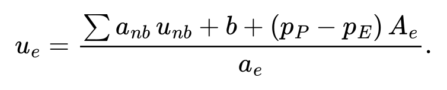

Substitute this value as u\_eⁿᵉʷ into the blending u\_e = u\_eᵒˡᵈ + α\_u·(u\_eⁿᵉʷ − u\_eᵒˡᵈ) and multiply by a\_e/α\_u:

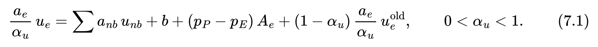

Properties of this formulation:

- at convergence u\_e = u\_eᵒˡᵈ, and (7.1) reduces to the original equation (4.1). **Relaxation does not change the converged solution**, only the path to it;
- the diagonal coefficient grows by a factor of 1/α\_u, and diagonal dominance becomes strict. Iterative linear solvers converge faster;
- the coefficient d\_e in the correction formula (4.5) is computed from the increased coefficient: d\_e = A\_e / (a\_e/α\_u) = α\_u·A\_e / a\_e.

### 7.3. Relaxing the pressure

The pressure is corrected not by the full correction but by a fraction of it:

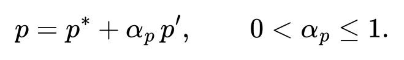

The velocity, however, is corrected by the **full** correction according to (4.6). Otherwise the corrected velocity would not satisfy continuity, which is the whole reason p' was computed.

### 7.4. Relaxation as a pseudo-time step

Rewrite (7.1) by moving u\_eᵒˡᵈ to the left-hand side:

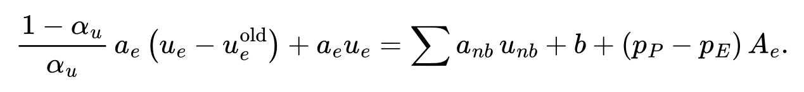

The first term has the form of an implicit approximation of the transient term ρ·ΔV·(u − uᵒˡᵈ)/Δt with a "pseudo time step"

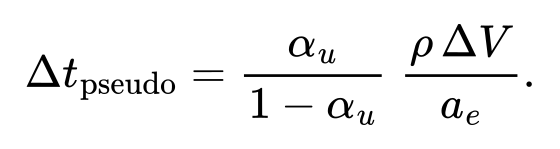

In other words, SIMPLE with under-relaxation is an implicit march in pseudo-time towards the steady solution, with a different step at each node. The smaller α\_u, the smaller the step: the iterations are more stable, but more of them are needed.

### 7.5. Choosing the relaxation factors

There are no universal values; they are tuned to the problem. The typical range is α\_u = 0.5…0.8, α\_p = 0.2…0.8. Ferziger and Perić [7] show that for SIMPLE the rule


is close to optimal, for example α\_u = 0.7, α\_p = 0.3; these are the values used in the program.

Signs of a poor choice: residuals grow or oscillate without decaying, so the factors should be reduced; residuals decrease very slowly and monotonically, so the factors can be increased.

### 7.6. Convergence criterion

The iterations are stopped when all discrete equations are satisfied with sufficient accuracy. For each equation a **residual** is computed: how far the current field is from satisfying the equation, summed over all nodes:


and R\_v is analogous to R\_u. Here b\_p' is the right-hand side of equation (4.7), i.e. the mass imbalance, and ρU²L and ρUL are the force and flow-rate scales (per unit depth) that make the residuals dimensionless. The momentum residual is computed with the current fields before solving the system. Relaxation does not enter it: when u\_e = u\_eᵒˡᵈ, the relaxation terms in (7.1) cancel each other.

The computation stops when R\_u, R\_v and R\_mass are below the prescribed tolerance. The criterion "the field has stopped changing" is worse: with strong relaxation the changes per iteration are small even when the solution is still far away.

### 7.7. Unsteady problems

SIMPLE also applies to unsteady problems. The transient term is discretized with the implicit Euler scheme: a\_P⁰ = ρ·ΔV/Δt is added to a\_P, and the term a\_P⁰·φᵖʳᵉᵛ (the value from the previous time step) is added to b. At each time step the SIMPLE iterations are carried out to convergence. The scheme is implicit, so there is no Courant condition for stability, and the time step is limited only by accuracy. For unsteady problems the PISO and SIMPLEC variants (Section 8) are used more often, since they need fewer iterations per step.

---

## 8. Variants of the method

The simplification (4.5) makes SIMPLE simple but slow to converge. Several improvements are known.

- **SIMPLER** (SIMPLE Revised; Patankar, Ch. 6). The pressure is obtained not from the correction but from a separate equation of the same form as (4.7). Instead of u\* it contains "pseudo-velocities" û\_e = (Σ a\_nb·u\_nb + b)/a\_e, computed without the pressure. The correction p' is used only to correct the velocity, not the pressure. If the velocity field is guessed correctly, SIMPLER immediately gives the correct pressure. An iteration is more expensive (one more equation), but significantly fewer iterations are needed.
- **SIMPLEC** (SIMPLE Consistent; Van Doormaal & Raithby, 1984 [4]). Instead of dropping Σ a\_nb·u'\_nb, the neighbour corrections are assumed to be roughly equal to the correction at the node: Σ a\_nb·u'\_nb ≈ u'\_e·Σ a\_nb. This gives d\_e = A\_e / (a\_e − Σ a\_nb), where a\_e is the diagonal coefficient including relaxation, i.e. a\_e/α\_u from (7.1): d\_e = A\_e / (a\_e/α\_u − Σ a\_nb). Pressure relaxation then often becomes unnecessary (α\_p = 1).
- **PISO** (Pressure-Implicit with Splitting of Operators; Issa, 1986 [5]). After the first correction, a second one is performed that accounts for the dropped term using the already computed u'. It was designed for unsteady problems: with a small time step it gives an accurate solution in one outer iteration per step.

The test program, a lid-driven cavity flow computation in Octave, is available at: https://github.com/Semen1996/incompressible-flow-simple-method.

---

## References

1. Patankar S. V. _Numerical Heat Transfer and Fluid Flow._ — Hemisphere, 1980.
2. Patankar S. V., Spalding D. B. A calculation procedure for heat, mass and momentum transfer in three-dimensional parabolic flows. _Int. J. Heat Mass Transfer_, 15 (1972), 1787–1806.
3. Harlow F. H., Welch J. E. Numerical calculation of time-dependent viscous incompressible flow of fluid with free surface. _Physics of Fluids_, 8 (1965), 2182–2189.
4. Van Doormaal J. P., Raithby G. D. Enhancements of the SIMPLE method for predicting incompressible fluid flows. _Numerical Heat Transfer_, 7 (1984), 147–163.
5. Issa R. I. Solution of the implicitly discretised fluid flow equations by operator-splitting. _J. Comput. Phys._, 62 (1986), 40–65.
6. Rhie C. M., Chow W. L. Numerical study of the turbulent flow past an airfoil with trailing edge separation. _AIAA Journal_, 21 (1983), 1525–1532.
7. Ferziger J. H., Perić M. _Computational Methods for Fluid Dynamics._ 3rd ed., Springer, 2002.
8. Simulating fluid flow with Chorin's method. — https://github.com/Semen1996/incompressible-flow-chorin-method
9. Solving the steady-state heat equation. Part 1. The one-dimensional case. https://github.com/Semen1996/steady-state-heat-1d
10. Solving the steady-state heat equation. Part 2. The two-dimensional case. https://github.com/Semen1996/steady-state-heat-2d
